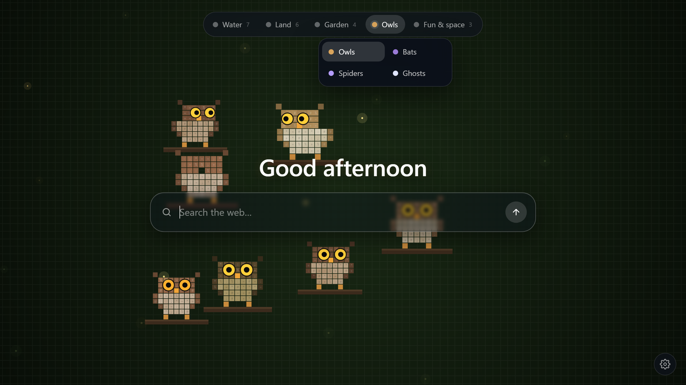
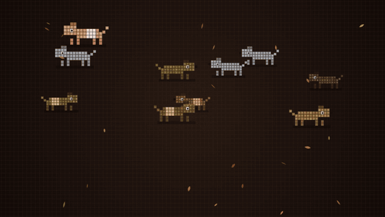
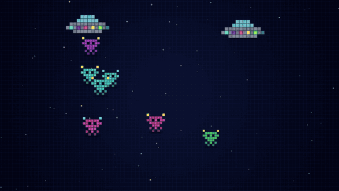
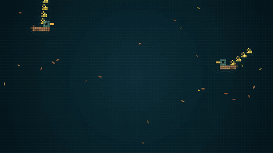
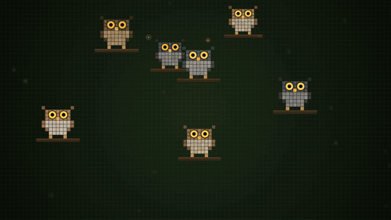
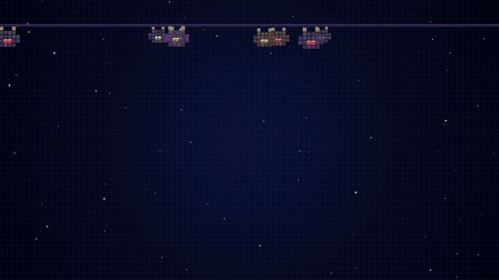
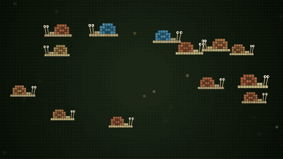
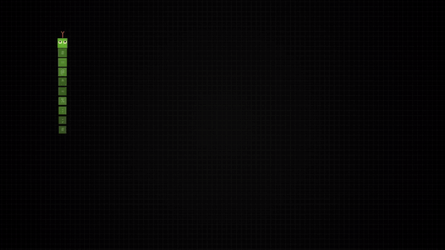
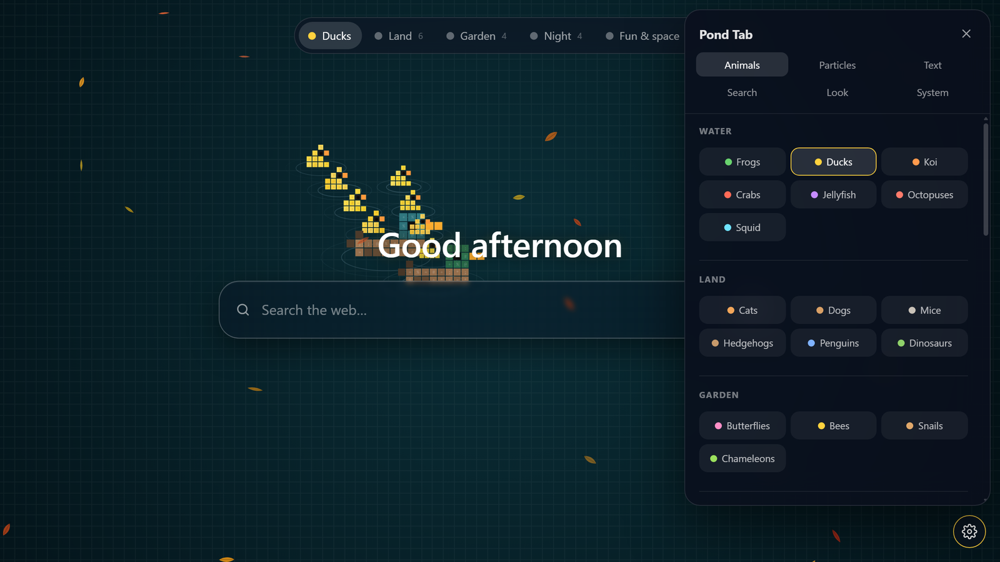
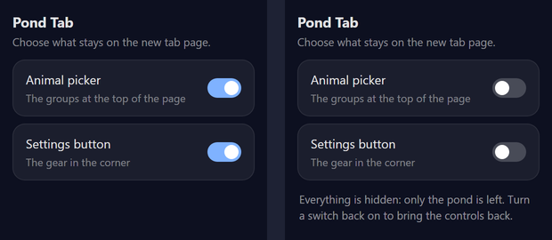

<h1 align="center">🐧 Critter Tab</h1>

  <b>A living new tab page for Chromium browsers.</b> 
  Penguins, ducks, owls, a snake and twenty more animals made of ASCII cells wander across your background and react to every click.

  
  
  
  

**24 animals**, each with its own personality and its own reaction to a click. **No dependencies, no network requests, no tracking.** Everything is drawn on a single `<canvas>`.

## What it looks like

Click the page and everybody reacts in their own way.

<table>
<tr>
<td align="center" valign="top" width="50%"> <b>Dogs</b> A click throws a ball. A dog fetches it, brings it back and waits for the next throw.</td>
<td align="center" valign="top" width="50%"> <b>UFOs and aliens</b> A click sends a saucer to beam up the nearest alien and set it down somewhere else.</td>
</tr>
<tr>
<td align="center" valign="top"> <b>Ducks</b> The ducklings scatter and the mother gathers them back into a line.</td>
<td align="center" valign="top"> <b>Owls</b> They turn their heads a full 180°, fly to new perches on a click, and hoot if you click one directly.</td>
</tr>
<tr>
<td align="center" valign="top"> <b>Bats</b> The whole colony tears loose, wheels around the screen and returns to its spots.</td>
<td align="center" valign="top"> <b>Snails</b> They leave a shiny trail, hide in their shells and put their eye stalks out one by one.</td>
</tr>
<tr>
<td align="center" valign="top" colspan="2"> <b>Snake</b> The classic phone game: a click drops an apple, the snake eats it and grows.</td>
</tr>
</table>

## The menagerie

The animals are sorted into groups. The bar at the top of the page has one button per group, and a click opens a small menu with its animals.

| Group | Animals |
|---|---|
| 🌊 **Water** | frogs, ducks, koi, crabs, jellyfish, octopuses, glowing squid |
| 🐾 **Land** | cats, dogs, mice, hedgehogs, penguins, dinosaurs |
| 🌿 **Garden** | butterflies, bees, snails, chameleons |
| 🌙 **Night** | owls, bats, spiders, ghosts |
| 🛸 **Fun & space** | UFOs and aliens, slimes, snake |

A right-click usually startles or annoys: bees chase your cursor in an angry swarm, mice dive into their holes.

## Settings

<table>
<tr>
<td width="62%"></td>
<td valign="top">

The **settings panel** (the gear in the bottom corner) has six tabs: animals, particles, text, search, look and system. Every animal has its own sliders, and a double-click on a value resets it. Your settings can be exported to and imported from a JSON file.

You also get weather (snow, sakura petals, leaves, rain, fireflies, stars, bubbles, embers or your own characters), background themes, a clock, a greeting, a countdown and a search box with a choice of engine.

The interface is available in English and Russian.

</td>
</tr>
</table>

### Hide the controls

Click the extension icon in the toolbar to open a small popup with **two switches**: the animal picker and the settings button. Changes apply instantly in tabs that are already open. Turn both off and the page is just the pond.

## Install

1. Download this repository (`Code → Download ZIP`) or clone it.
2. Open `chrome://extensions` and turn on **Developer mode**.
3. Click **Load unpacked** and choose the [`extension/`](extension) folder.
4. Open a new tab.

It works in Chrome and in other Chromium-based browsers (Edge, Brave, Opera, Vivaldi).

## Privacy

There are no analytics, no trackers and no external requests, and all code runs locally. Settings are stored in the tab's own `localStorage`. The only permission, `search`, lets the search box use the search engine you have chosen in your browser.

## License

Released under the [MIT License](LICENSE).
